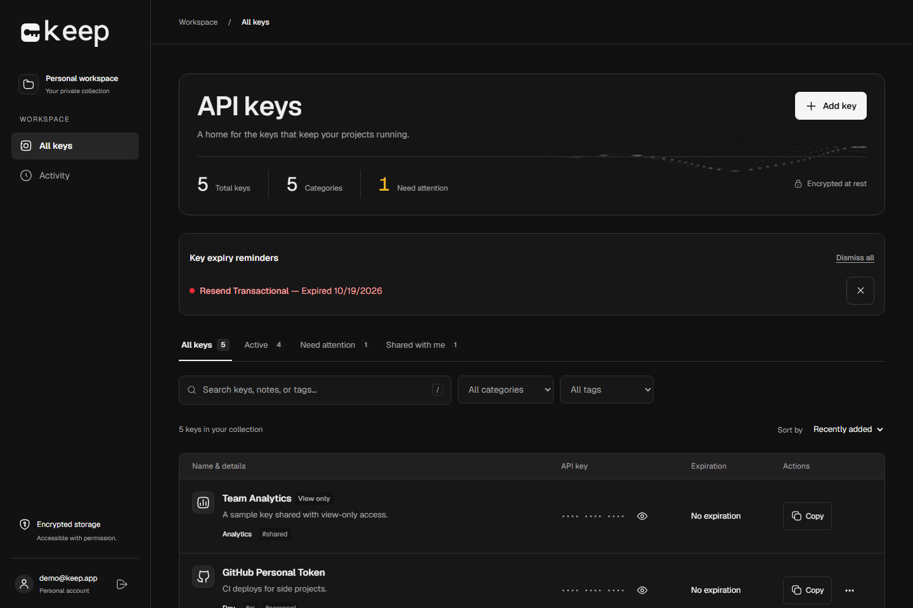

# Keep

An API key vault for organizing credentials, managing shared access, and tracking activity across your projects.

[Live application](https://keep-umber-eta.vercel.app) · [Development guide](docs/development.md) · [Deployment guide](docs/deployment.md)

[](https://github.com/eloooong/keep/actions/workflows/checks.yml)



## Overview

Keep brings API credentials into one workspace with searchable metadata, explicit sharing permissions, and an activity history. It is built with Next.js, React, TypeScript, and Supabase, with a responsive dark interface.

| Capability          | Details                                                                  |
| ------------------- | ------------------------------------------------------------------------ |
| Credential storage  | Server-side AES-256-GCM encryption for stored key values                 |
| Organization        | Search by name, notes, or tags; filter by category and tag               |
| Shared access       | Grant view or edit permissions and revoke access                         |
| Activity history    | Record key changes and access, retaining history after deletion          |
| Expiration tracking | Identify upcoming expirations and optionally send email reminders        |
| Authentication      | Email/password, Google, and GitHub through configured Supabase providers |

## Quick start

**Requirements:** Node.js 24 and npm. Docker is needed only for the local Supabase stack.

### 1. Install dependencies

```sh
git clone https://github.com/eloooong/keep.git
cd keep
npm ci
```

### 2. Configure the environment

Copy `.env.example` to `.env.local`:

```sh
cp .env.example .env.local
```

To explore the application without configuring external services, set:

```dotenv
NEXT_PUBLIC_DEMO_MODE=true
```

This mode uses shared, in-memory sample data that may reset on restart or redeployment.

### 3. Start the application

```sh
npm run dev
```

Open [localhost:3000](http://localhost:3000).

For persistent accounts and credentials, use the [local development guide](docs/development.md) to configure Supabase and the encryption key. Demo mode must be enabled explicitly; missing configuration never bypasses authentication.

## Security model

Key values are encrypted on the server before storage. Access is enforced through server-side authorization and PostgreSQL row-level security. Owners manage sharing; recipients receive view or edit permissions.

Encryption is **at rest**, not end-to-end: the application server can decrypt values for authorized requests. Keep the server encryption key private and backed up. Replacing or losing it makes existing encrypted values unreadable.

See the [architecture guide](docs/architecture.md) for the data flow, access rules, and service boundaries.

## Development

| Command                | Purpose                                                           |
| ---------------------- | ----------------------------------------------------------------- |
| `npm run dev`          | Start the development server                                      |
| `npm run check`        | Run ESLint, generate route types, check TypeScript, and run tests |
| `npm run format:check` | Verify source and documentation formatting                        |
| `npm run build`        | Create a production build                                         |
| `npm start`            | Serve the production build                                        |

Tests use Node's test runner and PGlite to exercise database permissions, ownership constraints, audit behavior, encryption, and reminder delivery logic without an external database. GitHub Actions runs formatting, lint, type checks, tests, and a demo-mode production build on every push and pull request.

Browser test setup and integration checks are documented in the [development guide](docs/development.md).

## Project structure

```text
src/
  app/           Routes, server actions, and styles
  components/    Vault, authentication, and shared UI
  utils/         Encryption, service clients, and demo data
supabase/        Database schema, migrations, and local configuration
tests/           Application, database, and browser tests
scripts/         Local backend and product-film tooling
docs/            Development, architecture, and deployment guides
```

## Documentation

| Guide                                                        | Contents                                            |
| ------------------------------------------------------------ | --------------------------------------------------- |
| [Development](docs/development.md)                           | Local setup, environment configuration, and testing |
| [Architecture](docs/architecture.md)                         | Data flow, permissions, and service boundaries      |
| [Deployment](docs/deployment.md)                             | Hosting, database upgrades, and expiry reminders    |
| [Social sign-in](docs/social-sign-in.md)                     | OAuth provider configuration and callbacks          |
| [Animation attribution](src/components/react-bits/README.md) | React Bits adaptations and third-party licenses     |
